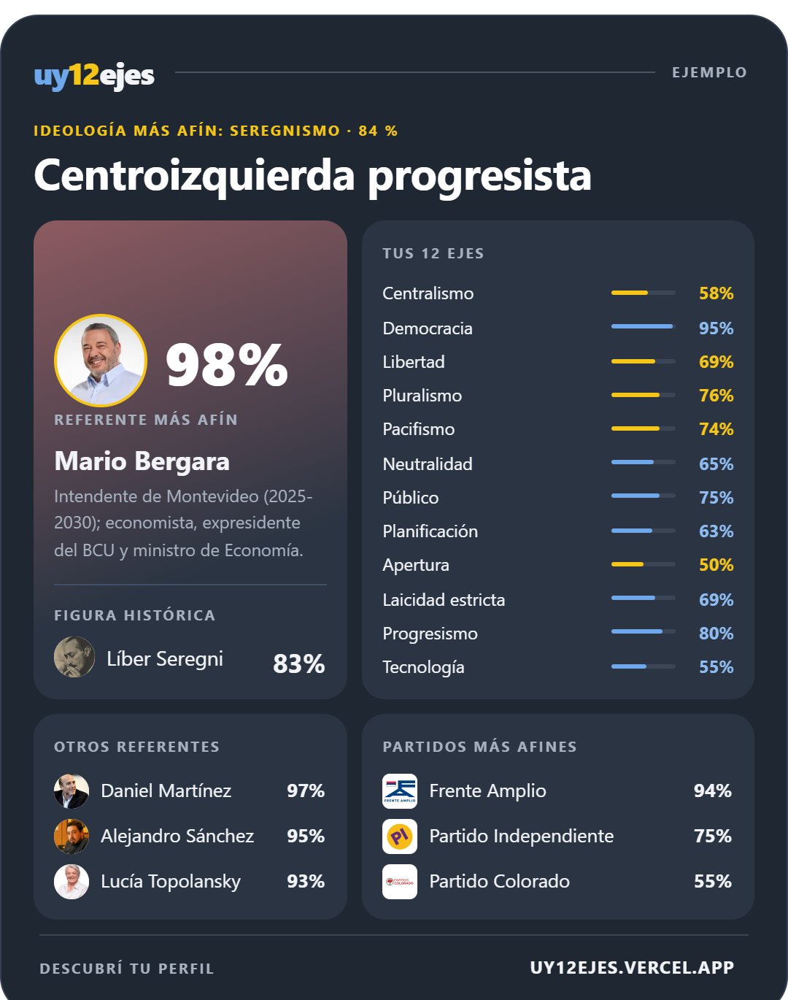
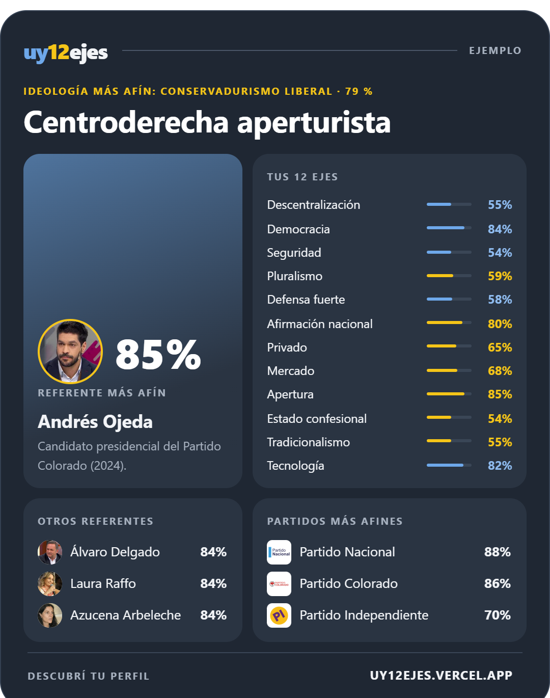
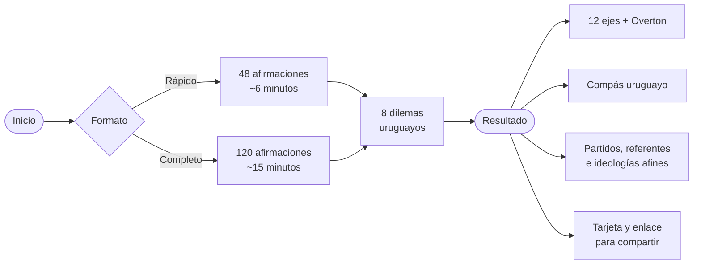
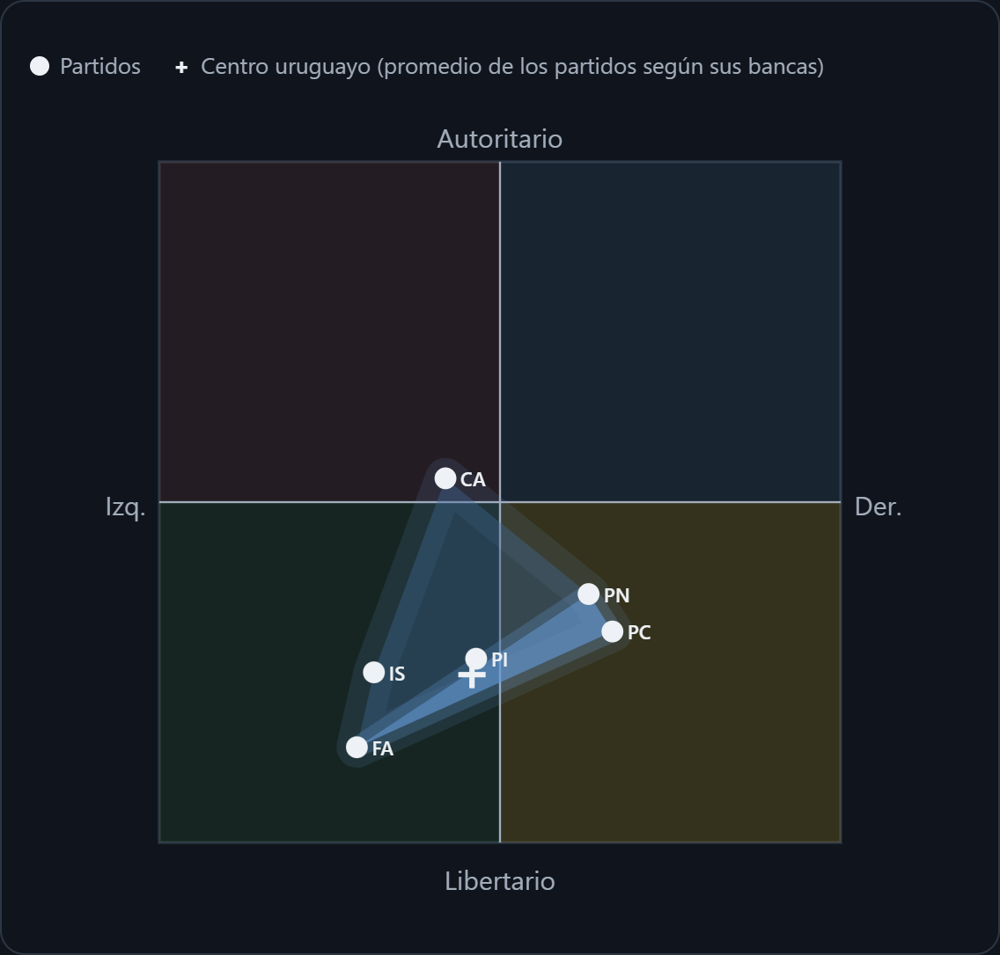
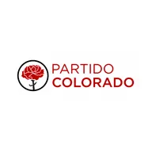
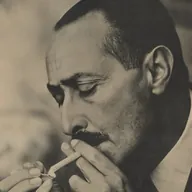
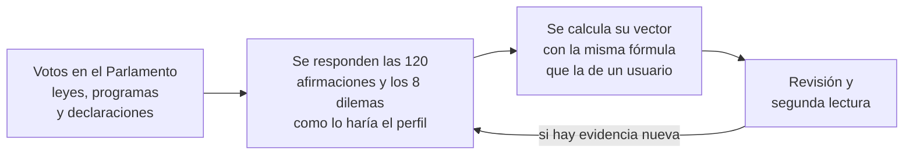

<a href="https://uy12ejes.vercel.app">
  <picture>
    <source media="(prefers-color-scheme: dark)" srcset="docs/img/logo-oscuro.svg">
    
  </picture>
</a>

### El test político de 12 ejes pensado para Uruguay

¿Realmente conocés tu ideología política? Descubrí dónde estás en doce dimensiones, 
qué partido piensa más parecido a vos y qué referente uruguayo está más cerca de tus ideas.

 

  

<table>
<tr>
<td align="center"><b>Si respondieras como Yamandú Orsi</b>  </td>
<td align="center"><b>Si respondieras como Luis Lacalle Pou</b>  </td>
</tr>
</table>

Tarjetas de ejemplo como las que genera el sitio al terminar el test.

 

 

> [!NOTE]
> uy12ejes es una herramienta para explorar ideas, no un instrumento científico. Una afinidad alta significa que tus respuestas se parecen a un perfil, no que pertenezcas a un partido ni que debas votarlo.
>
> **Datos actualizados a noviembre de 2026.** La ventana de Overton y las posiciones político-partidarias e ideológicas están ajustadas a esa fecha e intentan ser lo más objetivas posible según la información y los datos utilizados.

---

## Contenido

1. [Qué es](#qué-es)
2. [Cómo funciona](#cómo-funciona)
3. [Los 12 ejes](#los-12-ejes)
4. [Metodología](#metodología)
5. [Cálculos](#cálculos)
6. [El compás uruguayo](#el-compás-uruguayo)
7. [La ventana de Overton uruguaya](#la-ventana-de-overton-uruguaya)
8. [Partidos](#partidos)
9. [Personalidades](#personalidades)
10. [Ideologías](#ideologías)
11. [Tendencias que muestran los datos](#tendencias-que-muestran-los-datos)
12. [Cómo se ubica a cada perfil](#cómo-se-ubica-a-cada-perfil)
13. [Límites y advertencias](#límites-y-advertencias)
14. [Privacidad](#privacidad)
15. [Documentación y créditos](#documentación-y-créditos)

---

## Qué es

**uy12ejes** es un test político multieje calibrado para la realidad uruguaya. En lugar de reducir la política a una línea izquierda–derecha, mide **doce dimensiones por separado**. Así podés estar en un extremo en un eje y en el centro en otro, y el test muestra esa combinación en vez de promediarla.

Lo que lo hace distinto de los tests genéricos:

| | |
|---|---|
| 🇺🇾 **Calibrado para Uruguay** | Las preguntas mezclan principios universales con debates concretos del país: la dictadura y la Ley de Caducidad, la LUC, las AFAP, ANCAP, la laicidad, el Mercosur, UPM, la marihuana regulada. |
| 🧭 **Centro uruguayo, no global** | El "centro" no es un punto teórico. Se calcula con la posición de los partidos con bancas, ponderada por su peso en Diputados. |
| 🪟 **Ventana de Overton** | Cada eje muestra qué posiciones son mayoritarias, aceptables, radicales o impensables hoy en Uruguay. |
| 🧑‍⚖️ **Perfiles auditados** | Los 6 partidos, 59 referentes y 22 ideologías responden el mismo test que vos, a partir de votos, leyes, programas y declaraciones públicas. |
| 📤 **Para compartir** | Un enlace a tu resultado y una tarjeta en imagen lista para redes. |

---

## Cómo funciona

1. **Elegís el formato.** Rápido (48 afirmaciones) o completo (120). El rápido toma 4 afirmaciones de cada eje, elegidas para cubrir los dos polos.
2. **Respondés afirmaciones** en una escala de cinco niveles, de *Muy de acuerdo* a *Muy en desacuerdo*. También podés responder *No sé*, que no cuenta.
3. **Resolvés 8 dilemas**: escenarios uruguayos de opción múltiple que tocan uno o dos ejes a la vez.
4. **Ves tu resultado**: tu etiqueta, tu posición en los 12 ejes frente a la ventana de Overton, el compás con los partidos, y los partidos, referentes, figuras históricas e ideologías más afines.

---

## Los 12 ejes

Cada eje va de **0** (polo A) a **100** (polo B). El 50 es el punto medio, no "el centro uruguayo": ese se calcula aparte.

| # | Eje | Polo A ⟷ Polo B | Qué mide |
|:-:|---|---|---|
| 01 | **Territorio** | Descentralización ⟷ Centralismo | Dónde se decide: cuánto poder para intendencias, municipios y comunidades, frente a reglas iguales fijadas por el gobierno nacional. No mide el tamaño del Estado. |
| 02 | **Representación** | Democracia ⟷ Autocracia | Quién debe gobernar y bajo qué controles, incluida la memoria de 1968–1985 y la democracia directa. |
| 03 | **Poder** | Seguridad ⟷ Libertad | Hasta dónde puede llegar el Estado sobre la vida de cada uno: vigilancia, penas y prohibiciones, frente a privacidad y autonomía. |
| 04 | **Inmigración** | Asimilación ⟷ Pluralismo | Si quien llega debe adaptarse a la cultura local o si la diversidad es un valor en sí; cuánta apertura migratoria. |
| 05 | **Diplomacia** | Defensa fuerte ⟷ Pacifismo | Actitud ante la fuerza armada: gasto militar y disuasión, frente a negociación, desarme y organismos internacionales. |
| 06 | **Intervención** | Neutralidad ⟷ Afirmación nacional | Mantenerse al margen de los asuntos de otros países, o defender los intereses propios con firmeza y buscar protagonismo. |
| 07 | **Economía** | Público ⟷ Privado | Quién debe ser dueño y prestador de bienes y servicios: el Estado y lo colectivo, o los privados. |
| 08 | **Control** | Planificación ⟷ Mercado | Cuánto debe intervenir el Estado en precios, salarios, impuestos y moneda, sin importar quién sea dueño de las empresas. |
| 09 | **Comercio** | Protección ⟷ Apertura | Proteger la producción nacional de la competencia externa, o abrirse al comercio y la inversión extranjera. |
| 10 | **Religión** | Laicidad estricta ⟷ Estado confesional | El lugar de la religión en lo público (no tu fe personal). Entre 40 y 80 se lee como *laicidad abierta*. |
| 11 | **Moral** | Progresismo ⟷ Tradicionalismo | Valores culturales y derechos civiles: cambio social, género y sexualidad, frente a familia tradicional y costumbres. |
| 12 | **Tecnología** | Tecnología ⟷ Naturaleza | Confianza en la técnica y el desarrollo productivo, frente a precaución ambiental y preservación. |

<b>Por qué estos ejes se adaptan a Uruguay</b>

 

- **Territorio** se llama así, y no "Estructura", porque en Uruguay el debate es sobre intendencias, municipios y el peso de Montevideo, no sobre federalismo.
- **Representación** incluye la memoria de la dictadura (1973–1985) y los mecanismos de democracia directa (plebiscitos y referéndums), que en Uruguay se usan mucho.
- **Economía** y **Control** se separan a propósito. Uruguay mantiene empresas públicas fuertes (ANCAP, UTE, ANTEL, OSE, BROU) y rechazó privatizarlas en 1992 y 2003, pero tiene jubilación mixta con AFAP, salud mixta y Consejos de Salarios tripartitos.
- **Religión** mide solo la religión en lo público. Uruguay es uno de los países más laicos de América, y el eje distingue entre la laicidad estricta de tradición batllista y una laicidad abierta a expresiones religiosas.
- **Tecnología** recoge debates locales: la matriz eléctrica renovable, el Plan Ceibal, la celulosa (UPM), la megaminería (Aratirí), los agrotóxicos y la prohibición de la energía nuclear.

---

## Metodología

### Las afirmaciones

Hay **120 afirmaciones**, 10 por eje: **6 fundamentales** (principios que valen en cualquier país) y **4 uruguayas** (debates concretos del país). En cada eje hay afirmaciones de los dos polos, para que estar "de acuerdo con todo" no empuje siempre hacia el mismo lado.

| Respuesta | Valor |
|---|:-:|
| Muy de acuerdo | 1 |
| De acuerdo | 0,75 |
| Neutral | 0,5 |
| En desacuerdo | 0,25 |
| Muy en desacuerdo | 0 |
| No sé | *no cuenta* |

### Reglas especiales

- **Afirmaciones extremas.** Algunas afirmaciones marcan el borde de un eje: la pena de muerte, las fronteras abiertas para cualquiera, abolir las Fuerzas Armadas, una religión oficial, frenar el crecimiento económico. Solo cuentan cuando estás de acuerdo: rechazarlas cuenta como *Neutral*, para no empujar al polo contrario a todo el que las rechaza. Ninguna aparece en el formato rápido.
- **Pesos.** Las dos afirmaciones uruguayas de Representación sobre la dictadura (el golpe de 1973 y los juicios por los crímenes de Estado) pesan la mitad, para que el debate sobre la memoria, que también tiene su propio dilema, no domine un eje que mide la democracia en general.
- **Dilemas.** Cada opción de un dilema trae un valor fijo para uno o dos ejes. Elegirla suma una respuesta más con ese valor, así que un dilema nunca pesa más que una afirmación.

### Los 8 dilemas

| Dilema | Escenario | Ejes |
|---|---|---|
| Memoria | Aparecen restos de un desaparecido en un predio militar. | Representación, Poder |
| Un presidente popular | Un presidente con 70 % de apoyo quiere gobernar por decreto un año. | Representación, Poder |
| AFAP y jubilaciones | El sistema jubilatorio tiene déficit. | Economía, Control |
| ANCAP | ANCAP pierde plata. | Economía, Comercio |
| Inmigración | Llegan miles de inmigrantes de Venezuela, Cuba y otros países. | Inmigración |
| Conflicto internacional | Una potencia invade a un país vecino suyo. | Intervención, Diplomacia |
| Religión en lo público | Una intendencia quiere poner una estatua de la Virgen en la rambla. | Religión, Moral, Inmigración |
| Marihuana y consumo | Aumenta el consumo problemático entre los jóvenes. | Poder, Moral |

El detalle de cada afirmación y de cada opción está en [EJES-Y-PREGUNTAS.md](EJES-Y-PREGUNTAS.md).

---

## Cálculos

### Posición en cada eje

Cada respuesta se convierte en un valor de 0 a 100 en dirección al polo B. Si la afirmación defiende el polo A, el valor se invierte:

$$
v_i = \begin{cases} 100 \cdot a_i & \text{si la afirmación defiende el polo B} \\ 100 \cdot (1 - a_i) & \text{si defiende el polo A} \end{cases}
$$

donde $a_i$ es tu nivel de acuerdo (de 0 a 1). La posición en el eje es el **promedio ponderado** de esos valores, sumando las opciones de dilema que tocan el eje:

$$
\text{posición}_e = \frac{\sum_i w_i \, v_i}{\sum_i w_i}
$$

### Intensidad

| Distancia al 50 | Lectura |
|:-:|---|
| menos de 10 | Centro |
| 10 a 25 | Inclinado |
| 25 a 40 | Marcado |
| 40 o más | Muy marcado |

### Afinidad con partidos, referentes e ideologías

La afinidad compara tu posición con la de cada perfil en todos los ejes donde los dos tienen dato:

$$
d = \frac{1}{n}\sum_{e=1}^{n} \delta_e \cdot |u_e - p_e|
\qquad
\text{afinidad} = (100 - 2d)\cdot \min\left(1, \frac{n}{8}\right)
$$

- $\delta_e = 1{,}25$ cuando están en **lados opuestos** del eje y los dos a más de 15 puntos del medio. Así, no es lo mismo diferir dentro del mismo lado que estar en veredas enfrentadas.
- El factor $\min(1, n/8)$ penaliza a los perfiles comparados en menos de 8 ejes, como algunas figuras históricas.
- La **figura histórica más afín** se muestra solo si llega al **60 %**, para no forzar emparejamientos poco representativos.

### Etiqueta

Tu etiqueta combina la región del compás con un adjetivo:

- **progresista** si Moral está por debajo de 35, **conservador/a** si está por encima de 65;
- si no, el adjetivo del eje más marcado (a 30 o más del medio), por ejemplo *aperturista*, *laica* o *proteccionista*.

Ejemplos reales: *Centroizquierda progresista*, *Centroderecha aperturista*, *Centro conservador*, *Derecha liberal conservadora*.

---

## El compás uruguayo

El compás resume los 12 ejes en dos dimensiones:

$$
X = \frac{\text{Economía} + \text{Control}}{2}
\qquad
Y = \frac{\text{Representación} + (100 - \text{Poder})}{2}
$$

- **X**: de izquierda (más Estado) a derecha (más mercado).
- **Y**: de abajo (más libertades y garantías) hacia arriba (más autoridad y orden).

| Región | Condición |
|---|---|
| Izquierda socialista | X < 12 |
| Izquierda | 12 – 30 |
| Centroizquierda | 30 – 42 |
| Centro | 42 – 58 |
| Centroderecha | 58 – 70 |
| Derecha | 70 – 88 |
| Derecha liberal | X ≥ 88 |
| Autoritarismo (de izquierda, centro o derecha) | Y ≥ 60 |
| Libertarismo e izquierda libertaria | Y < 10 |

### Los partidos en el compás

  

FA: Frente Amplio · PN: Partido Nacional · PC: Partido Colorado · CA: Cabildo Abierto · IS: Identidad Soberana · PI: Partido Independiente. La zona sombreada es la ventana de Overton: lo más oscuro, el rango entre FA, PN y PC; lo más claro, el de todos los partidos con bancas.

### El centro uruguayo

El centro no es el punto (50, 50) sino **el promedio de los partidos ponderado por sus bancas** en Diputados (2025–2030). Hoy está en **X ≈ 46, Y ≈ 25**: algo a la izquierda del medio de la escala y claramente del lado democrático y de las libertades.

Tu resultado se lee respecto de ese centro:

| Distancia en X al centro uruguayo | Lectura |
|:-:|---|
| menos de 7 | en el centro |
| 7 a 20 | a la izquierda o derecha del centro |
| 20 o más | en la izquierda o en la derecha |

---

## La ventana de Overton uruguaya

La **ventana de Overton** es el rango de ideas que hoy se discuten en serio en un país. uy12ejes la calcula eje por eje con la posición de los partidos con bancas y de un grupo de legisladores auditados (2020–2030). Los valores están ajustados a **noviembre de 2026**:

| Zona | Qué significa | Cómo se calcula |
|---|---|---|
| 🟦 **Mayoritario** | Donde se mueven los tres grandes partidos. | Rango entre FA, PN y PC. |
| 🔷 **Aceptable** | Posiciones con representación parlamentaria. | Rango de todos los partidos y legisladores. |
| ◻️ **Radical** | En el borde: hoy ningún partido ni legislador lo defiende, pero existe en la discusión pública. | 15 puntos más allá de lo aceptable. |
| ⬜ **Impensable hoy** | Fuera del debate actual. | El resto de la escala. |

Cada barra también marca la **política vigente**: dónde está hoy la ley o la práctica del Estado.

| Eje | Mayoritario | Aceptable | Política vigente |
|---|:-:|:-:|:-:|
| Territorio | 45 – 70 | 33 – 70 | 65 |
| Representación | 3 – 15 | 0 – 32 | 12 |
| Poder | 40 – 75 | 19 – 87 | 50 |
| Inmigración | 54 – 76 | 33 – 90 | 65 |
| Diplomacia | 44 – 74 | 21 – 90 | 70 |
| Intervención | 29 – 69 | 26 – 80 | 35 |
| Economía | 23 – 65 | 3 – 88 | 38 |
| Control | 35 – 68 | 13 – 90 | 45 |
| Comercio | 48 – 83 | 5 – 83 | 60 |
| Religión | 29 – 59 | 0 – 88 | 15 |
| Moral | 20 – 61 | 10 – 90 | 25 |
| Tecnología | 20 – 55 | 10 – 95 | 45 |

---

## Partidos

Los seis partidos con bancas en la Cámara de Diputados (2025–2030):

<table>
<tr>
<td align="center" width="16%"> <b>Frente Amplio</b> 48 bancas</td>
<td align="center" width="16%"> <b>Partido Nacional</b> 29 bancas</td>
<td align="center" width="16%"> <b>Partido Colorado</b> 17 bancas</td>
<td align="center" width="16%"> <b>Cabildo Abierto</b> 2 bancas</td>
<td align="center" width="16%"> <b>Identidad Soberana</b> 2 bancas</td>
<td align="center" width="16%"> <b>Partido Independiente</b> 1 banca</td>
</tr>
</table>

| Partido | Etiqueta | X | Y | Rasgos |
|---|---|:-:|:-:|---|
| **Frente Amplio** | Izquierda progresista | 29 | 14 | Coalición de izquierda fundada en 1971; gobierna desde 2025. Empresas públicas fuertes, Consejos de Salarios, agenda de derechos y laicidad. |
| **Partido Nacional** | Centroderecha | 63 | 36,5 | Partido tradicional blanco; gobernó en 1990–1995 y 2020–2025. Regla fiscal, LUC, apertura comercial y seguridad. |
| **Partido Colorado** | Centroderecha aperturista | 66,5 | 31 | El partido que más años gobernó. Batllista y liberal: el más aperturista y uno de los más laicos. |
| **Cabildo Abierto** | Centro conservador | 42 | 53,5 | Fundado en 2019 por Guido Manini Ríos; se define artiguista. Estatismo moderado, defensa, seguridad y valores tradicionales. |
| **Identidad Soberana** | Centroizquierda conservadora | 31,5 | 25 | Fundado en 2022 por Gustavo Salle. Soberanista y antisistema: proteccionista, ambientalista y crítico de la Agenda 2030. |
| **Partido Independiente** | Centro progresista | 46,5 | 27 | Partido de centro liderado por Pablo Mieres; el más cercano al centro uruguayo. |

---

## Personalidades

**59 referentes**: 39 actuales y 20 figuras históricas, desde Artigas hasta Orsi. Algunos ejemplos:

<table>
<tr>
<td align="center" width="20%"> <b>Yamandú Orsi</b> Centroizquierda progresista</td>
<td align="center" width="20%"> <b>José Mujica</b> Izquierda progresista</td>
<td align="center" width="20%"> <b>Luis Lacalle Pou</b> Centroderecha aperturista</td>
<td align="center" width="20%"> <b>Julio M. Sanguinetti</b> Centro aperturista</td>
<td align="center" width="20%"> <b>Guido Manini Ríos</b> Centro conservador</td>
</tr>
<tr>
<td align="center"> <b>José Artigas</b> Izquierda proteccionista · histórico</td>
<td align="center"> <b>José Batlle y Ordóñez</b> Izquierda progresista · histórico</td>
<td align="center"> <b>Luis A. de Herrera</b> Derecha conservadora · histórico</td>
<td align="center"> <b>Wilson Ferreira</b> Izquierda · histórico</td>
<td align="center"> <b>Líber Seregni</b> Izquierda pluralista · histórico</td>
</tr>
</table>

| Región | Referentes |
|---|:-:|
| Izquierda socialista | 9 |
| Izquierda libertaria | 5 |
| Izquierda | 11 |
| Centroizquierda | 5 |
| Centro | 7 |
| Centroderecha | 5 |
| Derecha | 11 |
| Derecha liberal | 2 |
| Autoritarismo de centro | 2 |
| Derecha autoritaria | 2 |

> [!TIP]
> **Las figuras históricas se ubican por las posiciones de su época** y solo en los ejes donde tenían una postura. Artigas no tiene posición sobre las AFAP ni Batlle y Ordóñez sobre la marihuana: esos ejes y dilemas quedan sin dato y no cuentan en la afinidad.

Algunas ubicaciones que suelen sorprender, y por qué:

- **Álvaro Delgado** y **Julio María Sanguinetti** quedan en el **centro**, no en la centroderecha: defienden la regla fiscal y la independencia del Banco Central, pero también las empresas públicas y los Consejos de Salarios.
- **Jorge Batlle** es *Derecha liberal progresista*: muy pro mercado, pero laico, liberal en lo moral y defensor de regular las drogas.
- **Wilson Ferreira Aldunate** queda en la izquierda del compás por su programa económico de 1971 (reforma agraria, nacionalización de la banca).

---

## Ideologías

**22 ideologías**, entre tradiciones uruguayas y corrientes universales, agrupadas por la región del compás donde caen al responder el test:

| Espectro | Ideologías |
|---|---|
| Izquierda socialista | Tercerismo, Tupamarismo (etapa armada), Comunismo |
| Izquierda libertaria | Socialismo democrático, Progresismo, Anarquismo |
| Izquierda | Artiguismo, Batllismo, Neobatllismo, Wilsonismo, Seregnismo, Ecologismo |
| Centroizquierda | Socialdemocracia |
| Centro | Democracia cristiana, Soberanismo constitucionalista |
| Centroderecha | Liberalismo social, Conservadurismo social |
| Derecha | Herrerismo, Conservadurismo liberal |
| Derecha liberal | Liberalismo clásico |
| Libertarismo | Libertarismo |
| Autoritarismo de centro | Autoritarismo militar |

---

## Tendencias que muestran los datos

<table>
<tr>
<td width="50%" valign="top">

#### 🧭 Un centro corrido a la izquierda
El centro uruguayo está en **X ≈ 46**, por debajo del medio de la escala. El consenso sobre empresas públicas, Consejos de Salarios y Estado social hace que posiciones "de centro" en otros países se lean como centroderecha acá.

</td>
<td width="50%" valign="top">

#### 🗳️ Consenso democrático
En **Representación** la ventana mayoritaria va de **3 a 15**: todos los partidos grandes están firmemente del lado democrático. Es el eje con el debate más estrecho.

</td>
</tr>
<tr>
<td valign="top">

#### ⛪ Un país laico
La política vigente en **Religión** está en **15**, cerca de la laicidad estricta. Los partidos se mueven en la *laicidad abierta* (29–59), pero el Estado uruguayo sigue siendo de los más laicos de la región.

</td>
<td valign="top">

#### 🔗 Ejes que viajan juntos
**Economía y Control** están muy correlacionados: en Uruguay, quien defiende empresas públicas suele defender también la regulación. Los dos ejes se mantienen separados porque distinguen casos clave, como el **FA ortodoxo en lo macro** (Astori, Bergara, Orsi) o el **congelamiento de precios y salarios** de Pacheco.

</td>
</tr>
<tr>
<td valign="top">

#### 🌎 Apertura con matices
En **Comercio** la zona mayoritaria va de 48 a 83: nadie con peso propone cerrarse, pero hay distancia entre el Mercosur como prioridad (FA) y firmar tratados por fuera del bloque (PN y PC).

</td>
<td valign="top">

#### 🏛️ Los tradicionales, más plurales de lo que parecen
El Partido Colorado reúne desde batllistas de centro hasta liberales como Jorge Batlle o Gurméndez, y el Partido Nacional va de Delgado y Argimón, en el centro, a Bianchi y da Silva, en la derecha.

</td>
</tr>
</table>

---

## Cómo se ubica a cada perfil

Las posiciones de partidos, referentes e ideologías **no se ponen a mano**. Cada perfil responde el mismo test que un usuario:

1. **Evidencia.** Votos en el Parlamento, leyes que impulsó o vetó, programas de gobierno y declaraciones públicas. Sin evidencia, se responde *Neutral*.
2. **Respuestas.** Se responden las 120 afirmaciones y los 8 dilemas como lo haría ese perfil. Las posiciones extremas (*Muy de acuerdo* o *Muy en desacuerdo*) se reservan para las que lo definen.
3. **Cálculo.** El vector se obtiene con la misma función que usa el test, así que perfiles y usuarios se miden con la misma vara.
4. **Revisión.** Los perfiles pasan por una segunda lectura y se corrigen cuando aparece evidencia nueva. Todos están en estado *auditado-borrador*.

Las respuestas de cada perfil, con sus notas, se pueden consultar en la carpeta [`app/auditoria/`](app/auditoria).

---

## Límites y advertencias

> [!IMPORTANT]
> - **Es una herramienta para explorar ideas**, no una encuesta ni un estudio científico. No tiene validación estadística con muestras de población.
> - **Las ubicaciones de partidos y referentes son estimaciones** basadas en evidencia pública y siguen en revisión. Un partido es una coalición de sectores: su posición es un agregado, no la de cada dirigente.
> - **Las preguntas tienen sesgos inevitables.** Se intentó compensarlos con afirmaciones de los dos polos en cada eje, afirmaciones extremas que solo cuentan si estás de acuerdo y simulaciones con votantes de todo el espectro.
> - **Las figuras históricas no son comparables del todo** con los políticos actuales: se ubican solo en lo que tenía sentido en su época.
> - **El enlace para compartir no es infalsificable**: no hay servidor, así que alguien con conocimientos técnicos podría fabricar un resultado.

Si ves un error en alguna ubicación, [abrí un issue](https://github.com/geronimososa/uy12ejes/issues) con la evidencia.

---

## Privacidad

- **Sin registro ni cuentas.**
- **Tus respuestas no salen de tu navegador.** El cálculo se hace en tu dispositivo y el progreso del test se guarda solo en la pestaña abierta.
- **El enlace del resultado** solo contiene tus 12 posiciones codificadas, no tus respuestas.
- El sitio usa **Vercel Analytics** para contar visitas de forma agregada, sin cookies ni datos personales.

---

## Documentación y créditos

| Documento | Contenido |
|---|---|
| [DISENO.md](DISENO.md) | Qué hace la app, cómo calcula y por qué. |
| [EJES-Y-PREGUNTAS.md](EJES-Y-PREGUNTAS.md) | Los 12 ejes, las 120 afirmaciones y los 8 dilemas, con su contexto uruguayo. |
| [OVERTON-Y-REFERENTES.md](OVERTON-Y-REFERENTES.md) | La ventana de Overton, los partidos, los referentes y la auditoría de cada perfil. |

**Fotos y logos.** Provienen de Wikimedia Commons, con licencias libres (dominio público, CC0, CC BY, CC BY-SA). El autor y la licencia de cada imagen están en la página [Créditos](https://uy12ejes.vercel.app/creditos) del sitio.

**Inspiración.** uy12ejes se inspira en la idea de los tests políticos multieje, como 12 Axes y Political Compass, pero no usa su código, sus preguntas, sus datos ni su diseño.

 

**[Hacé el test →](https://uy12ejes.vercel.app)**

Hecho en Uruguay 🇺🇾

